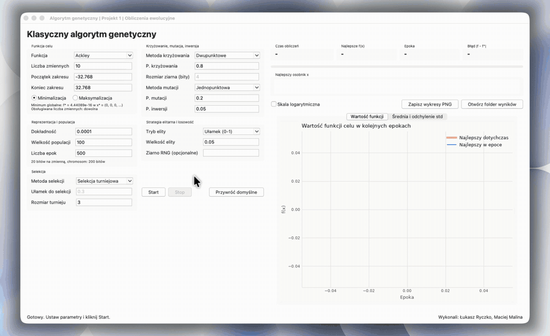

# Genetic Algorithm (Project 1)

A classic genetic algorithm with binary chromosomes and a Tkinter GUI.

Authors: Łukasz Ryczko, Maciej Malina



## Run

```bash
python3 -m venv .venv
source .venv/bin/activate
pip install -r app/requirements.txt
python app/main.py
```

Python needs Tkinter. On macOS with Homebrew: `brew install python-tk@3.12`.

## Folders

- `app/` source code (GUI, algorithm, test functions)
- `app/results/` CSV results of every run
- `report/` LaTeX report and figures
